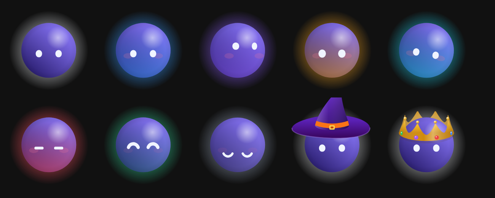

<div align="center">


# Orb

**Uma esfera brilhante que fica no topo da tela do seu PC e no seu celular Android, de olho nas suas sessões de agentes de IA (Claude Code, Codex, Gemini CLI e outros).**

Aprove permissões, acompanhe o que os agentes estão fazendo, solte um arquivo, converse com a IA — sem sair do que você está fazendo.




</div>

---

## O que o Orb faz

- 🤖 **Seus agentes ao vivo** — Claude Code, Codex, Gemini CLI, Cursor, Copilot CLI, OpenCode e outros: o que cada sessão lê, edita e roda, passo a passo.
- 🎨 **O Orb muda de cor com o estado** — azul trabalhando, roxo pensando, laranja esperando você, vermelho com erro, verde quando termina.
- ✅ **Aprovar sem ir ao terminal** — pedidos de permissão aparecem com **Permitir / Negar / Sempre**; perguntas do agente mostram as opções ali mesmo.
- 📱 **No celular** — o app Android recebe as sessões do PC pela rede local: aprove pedidos, veja o que terminou e use os widgets da tela inicial.
- 💬 **Chat** — com Claude e outros provedores, com sua chave ou pela assinatura que você já paga (Claude Code, Codex CLI, Gemini CLI…).
- 🎙️ **"OK Orb"** — comando de voz, offline com Parakeet.
- 📎 **Solte um arquivo no Orb** e pergunte sobre ele.
- 🔌 **Integrações** — GitHub, Stripe, Vercel, n8n, Notion, Cal.com e mais.

## Compilar

### Windows (e Linux)

Precisa de [Node.js](https://nodejs.org) e [Rust](https://rustup.rs).

```bash
cd windows
```

```bash
npm install
```

```bash
npm run tauri dev
```

Para gerar o instalador: `npm run pack` (sai em `windows/release/`, como `Orb-Windows-*-setup.exe` e `.msi`).

### Android

Precisa do [Android Studio](https://developer.android.com/studio) (ou do Android SDK com JDK 17).

```bash
cd android
```

```bash
./gradlew assembleDebug
```

O APK sai em `android/app/build/outputs/apk/debug/`. Para ligar o celular ao PC: no Orb do PC, abra **Ajustes → Link com o celular**, ligue o link e escaneie o QR code com o app.

## Atualizações

O Orb do Windows procura versões novas nos [Releases deste repositório](https://github.com/Halfszin/Orb/releases) e só instala depois do seu clique.

## Créditos e licença

O Orb é baseado no [Coucou](https://github.com/Louis-CFM/coucou), de Louis Raillé, e no Coucou for Android, de Rhytam Biswas, ambos sob a [licença MIT](LICENSE). O aviso de copyright original fica em [`LICENSE`](LICENSE) e [`android/LICENSE`](android/LICENSE), como a licença exige.

O nome "Coucou", o personagem Mochi, os sons e as imagens do projeto original **não** fazem parte da licença MIT (veja [`LICENSE-ASSETS.md`](LICENSE-ASSETS.md)). O Orb tem nome, visual e ícone próprios. **Os sons ainda são os originais** (`NotchBuddy/Resources/sounds/` e cópias em `windows/` e `android/`): servem para uso pessoal, mas precisam ser trocados antes de distribuir o app.
